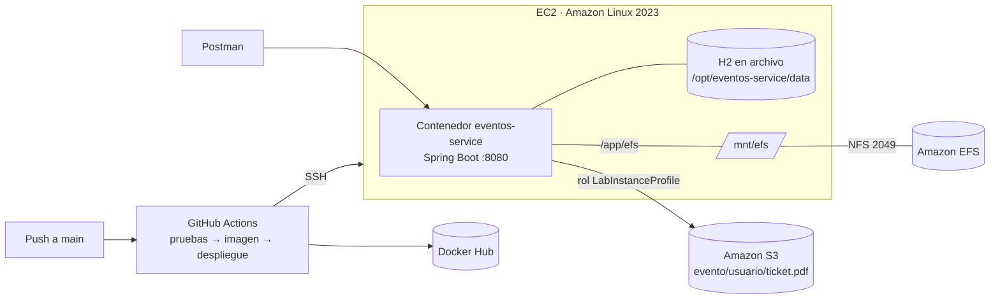

# eventos-service: reservas de eventos con tickets en EFS y AWS S3

Microservicio Spring Boot para un sistema de gestión de reservas de eventos con tickets. Cada ticket es un PDF personalizado que se genera en **Amazon EFS** (almacenamiento temporal) y se sube automáticamente a **Amazon S3**, organizado por evento y usuario. Cada push a `main` ejecuta un pipeline de **GitHub Actions** que prueba el código, publica la imagen en **Docker Hub** y la despliega en una instancia **EC2**.

## Índice

- [Arquitectura](#arquitectura)
- [Stack](#stack)
- [Endpoints](#endpoints)
- [Ciclo de vida de un ticket](#ciclo-de-vida-de-un-ticket)
- [Configuración](#configuración)
- [Ejecución local y pruebas](#ejecución-local-y-pruebas)
- [Despliegue continuo](#despliegue-continuo)
- [Estructura del proyecto](#estructura-del-proyecto)
- [Autora](#autora)

## Arquitectura



- **EFS** guarda la copia de trabajo de cada ticket. El sistema de archivos se monta en `/mnt/efs` de la EC2 y el contenedor lo ve en `/app/efs`.
- **S3** guarda el ticket definitivo en `evento{idEvento}/{usuario}/ticket{nnn}.pdf`, por ejemplo `evento1/usuariox/ticket001.pdf`, con metadatos (evento, usuario, código, versión y fecha de emisión).
- **Credenciales:** el código no contiene ninguna. En la EC2, el SDK de AWS usa el rol de la instancia (LabInstanceProfile), que AWS renueva solo. En local se leen de variables de entorno.
- **Integridad:** cada PDF tiene un SHA-256 que se guarda en la base de datos y se envía a S3 (`x-amz-checksum-sha256`, que S3 verifica al recibirlo). Se vuelve a comprobar en cada descarga.

## Stack

| Componente | Versión |
|---|---|
| Java | 21 |
| Spring Boot | 4.1.2 (Spring MVC, Data JPA, Validation, Actuator) |
| AWS SDK for Java v2 (S3) | 2.57.11 |
| Apache PDFBox | 3.0.8 |
| Base de datos | H2 en archivo (persistente en un volumen de la EC2) |
| Contenedor | Eclipse Temurin 21 JRE, usuario sin privilegios |
| CI/CD | GitHub Actions, Docker Hub, EC2 |

## Endpoints

Base: `http://<host>:8080`. Todas las respuestas de error son JSON con `status`, `mensaje`, `ruta` y, cuando corresponde, `detalles`.

### Tickets (`/api/tickets`)

| Método | Ruta | Descripción |
|---|---|---|
| `POST` | `/api/tickets` | **Genera** el ticket PDF en EFS y lo **sube automáticamente** a S3. Body: `compraId`, `nombreAsistente`, `correoAsistente` |
| `POST` | `/api/tickets/{id}/subir` | **Sube** (o vuelve a subir) a S3 el ticket que está en EFS |
| `GET` | `/api/tickets/{id}` | Detalle del ticket (estado, clave S3, ruta EFS, SHA-256, versión) |
| `GET` | `/api/tickets/{id}/descargar` | **Descarga** el PDF desde S3. Cabecera `X-Checksum-SHA256` |
| `GET` | `/api/tickets/descargar?usuario=&eventoId=` | **Descarga por usuario o por evento** (o ambos): ZIP con la estructura de carpetas de S3 y `SHA256SUMS.txt` |
| `PUT` | `/api/tickets/{id}` | **Modifica** `cantidad`, `nombreAsistente` o `correoAsistente`. Regenera el PDF y lo reemplaza en la **misma** clave de S3 y la **misma** ruta de EFS. Cambiar `eventoId` o `usuario` responde 400 |
| `DELETE` | `/api/tickets/{id}` | **Elimina** un ticket: valida que exista (404 si no), lo borra de S3 y de EFS y lo deja como `ELIMINADO` en el historial |
| `GET` | `/api/tickets/historial` | **Historial** de tickets generados. Filtros combinables: `usuario`, `eventoId`, `estado` (`GENERADO`, `SUBIDO`, `ELIMINADO`), `desde` y `hasta` (`yyyy-MM-dd`). Orden: más reciente primero |

### Eventos, compras y estadísticas

| Método | Ruta | Descripción |
|---|---|---|
| `GET` | `/api/eventos` | Lista de eventos con nombre, fecha, precio y entradas disponibles |
| `GET` | `/api/eventos/{id}` | Detalle de un evento |
| `POST` | `/api/eventos` | Crea un evento: `nombre`, `fecha` (`2027-03-20T14:00:00`), `lugar`, `precio`, `capacidad` |
| `POST` | `/api/compras` | Registra una compra (reserva): `eventoId`, `usuario`, `cantidad`. Valida la capacidad (409 si no hay cupo) |
| `GET` | `/api/compras/{id}` | Resumen de la compra: evento, entradas, precio unitario y total |
| `GET` | `/api/compras/{id}/resumen` | Resumen de compra en PDF con los datos reales (alias: `/api/resumen/descargar/{id}`) |
| `GET` | `/api/eventos/{id}/estadisticas` | **Estadísticas de ventas y reservas** del evento |
| `GET` | `/api/eventos/estadisticas` | Estadísticas de todos los eventos |

**Definiciones usadas en las estadísticas:**
- **Reserva:** compra registrada; las entradas quedan apartadas.
- **Venta:** compra con ticket emitido y vigente.

Por eso la respuesta distingue `reservas`, `entradasReservadas`, `ventas`, `entradasVendidas`, `entradasSinTicket`, `entradasDisponibles`, `ocupacionPorcentaje`, `recaudacion` (suma de las ventas), `usuariosDistintos` y `ticketsEliminados`.

### Archivos en un bucket (`/s3/{bucket}`)

| Método | Ruta | Descripción |
|---|---|---|
| `GET` | `/s3/{bucket}/objects?prefijo=` | Lista objetos; con `prefijo` muestra una carpeta (por ejemplo `evento1/`) |
| `GET` | `/s3/{bucket}/object?key=` | Descarga un objeto |
| `POST` | `/s3/{bucket}/object?key=` | Sube un archivo nuevo (multipart `file`); 409 si la clave ya existe |
| `PUT` | `/s3/{bucket}/object?key=` | Reemplaza el archivo en la misma carpeta y con el mismo nombre; 404 si no existe |
| `DELETE` | `/s3/{bucket}/object?key=` | Elimina validando antes que exista; 404 si no existe |

`GET /actuator/health` informa el estado de la aplicación; el pipeline lo usa para confirmar el despliegue.

## Ciclo de vida de un ticket

1. `POST /api/eventos` crea el evento y `POST /api/compras` registra la reserva del usuario.
2. `POST /api/tickets` genera el PDF con los datos reales (evento, fecha, asistente, entradas, precio unitario, total, código único) en `/app/efs/tickets/evento{id}/{usuario}/ticket{nnn}.pdf`.
3. El mismo PDF se sube a S3 con la clave `evento{id}/{usuario}/ticket{nnn}.pdf` y el estado pasa a `SUBIDO`. Si S3 no responde, el ticket queda en EFS como `GENERADO` y la respuesta indica cómo reintentar con `POST /api/tickets/{id}/subir`.
4. `PUT /api/tickets/{id}` aumenta la versión, recalcula el total si cambia la cantidad y reemplaza el archivo en la misma ruta.
5. `DELETE /api/tickets/{id}` borra los archivos y conserva el registro para el historial y las estadísticas.

El nombre de usuario forma parte de la ruta: se guarda en minúsculas y solo admite letras, números, punto, guion y guion bajo (3 a 40 caracteres)..

## Configuración

No hay secretos en el repositorio. Todo lo variable se toma de variables de entorno; para ejecutar en local, copie `.env.example` como `.env` (archivo excluido de git).

| Variable | Descripción | Valor por defecto |
|---|---|---|
| `S3_BUCKET` | Bucket donde se guardan los tickets | (obligatoria para subir a S3) |
| `AWS_REGION` | Región de AWS | `us-east-1` |
| `AWS_ACCESS_KEY_ID`, `AWS_SECRET_ACCESS_KEY`, `AWS_SESSION_TOKEN` | Credenciales de AWS Academy, solo para ejecución local | (en la EC2 se usa el rol de la instancia) |
| `EFS_BASE_PATH` | Carpeta de trabajo de los tickets | `./efs-local` (en el contenedor: `/app/efs`) |
| `DB_URL` | URL JDBC | `jdbc:h2:file:./data/eventos` (en el contenedor: `/app/data/eventos`) |

## Ejecución local y pruebas

```bash
./mvnw spring-boot:run      # http://localhost:8080
./mvnw test                 # 20 pruebas de integración
```

Las pruebas no necesitan AWS: usan un S3 simulado en memoria y una carpeta temporal en lugar de EFS. Cubren:
- la ruta `evento/usuario/ticket.pdf` y el contenido real del PDF;
- la subida automática y la manual;
- la integridad SHA-256 (incluido un archivo alterado en S3, que responde 502);
- el reemplazo en la misma clave al modificar;
- el 404 al eliminar algo inexistente;
- los ZIP por usuario y por evento;
- los filtros del historial y las estadísticas.

## Despliegue continuo

`.github/workflows/deploy.yml` se ejecuta con cada push a `main` (también se puede lanzar a mano):

1. **Pruebas:** `./mvnw verify` con JDK 21.
2. **Imagen:** construye el `Dockerfile` (multi-etapa) y publica `eventos-service:latest` y `eventos-service:<sha del commit>` en Docker Hub.
3. **Despliegue:** se conecta por SSH a la EC2 y ejecuta [`.github/scripts/desplegar-ec2.sh`](.github/scripts/desplegar-ec2.sh), que:
   - monta el EFS en `/mnt/efs` si no está montado y lo deja en `/etc/fstab`, para que vuelva a montarse si se reinicia la instancia;
   - prepara la carpeta de la base de datos;
   - reemplaza el contenedor por la versión del commit, con `-v /mnt/efs:/app/efs` y `-v /opt/eventos-service/data:/app/data`;
   - espera a que `/actuator/health` responda `UP`. Si no responde, muestra los logs y el pipeline falla.

**Secrets del repositorio:** `DOCKERHUB_USERNAME`, `DOCKERHUB_TOKEN`, `EC2_HOST` (IP elástica), `EC2_SSH_KEY` (llave privada del key pair), `S3_BUCKET` y `EFS_DNS` (DNS del sistema de archivos EFS).

**Infraestructura en AWS** (región `us-east-1`):

| Recurso | Configuración |
|---|---|
| EC2 | Amazon Linux 2023, con perfil de instancia `LabInstanceProfile` e IP elástica |
| Security group de la EC2 | Entrada 22 (SSH), 8080 (API) y NFS 2049 desde el mismo security group |
| EFS | VPC por defecto; cada mount target usa el security group de la EC2 |
| S3 | Bucket privado, con acceso público bloqueado |

## Estructura del proyecto

```
src/main/java/com/duoc/eventos_service/
├── config/        Cliente S3 (cadena de credenciales del SDK) y reloj con zona horaria de Chile
├── controller/    EventoController, CompraController, TicketController, AwsS3Controller
├── dto/           Records de entrada y salida con Bean Validation
├── exception/     Excepciones de dominio y manejador global de errores (JSON)
├── model/         Evento, Compra, Ticket y EstadoTicket
├── repository/    Repositorios JPA (historial y estadísticas resueltos en la base de datos)
└── service/       Lógica de eventos, compras y tickets; EFS, S3, PDF y checksums
.github/workflows/deploy.yml       Pipeline CI/CD
.github/scripts/desplegar-ec2.sh   Montaje de EFS y despliegue del contenedor en la EC2
Dockerfile                         Imagen multi-etapa, usuario sin privilegios
```

## Autora

| | |
|---|---|
| Estudiante | María Ibaceta Jofre |
| Carrera | Analista Programador |
| Asignatura | Desarrollo Cloud Native (CDY2204) |
